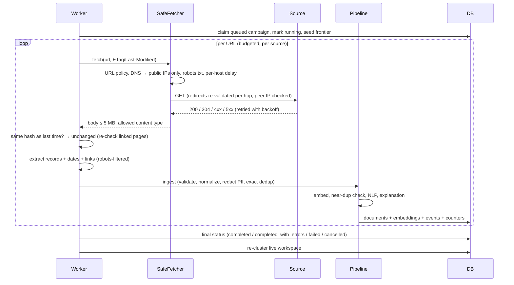
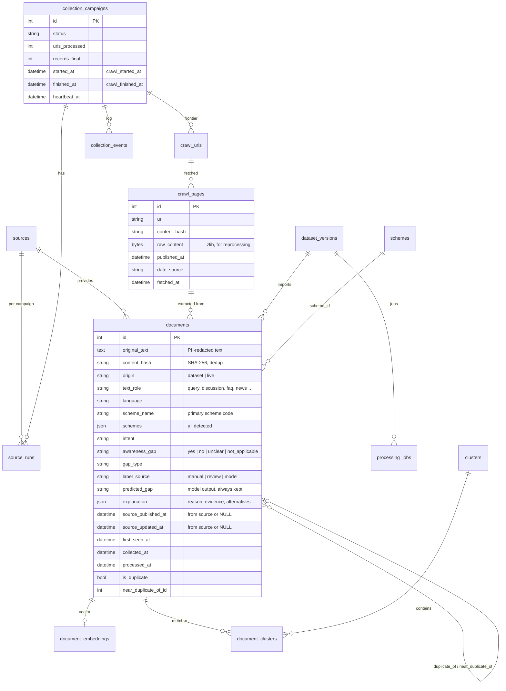

# Architecture

## Components

```mermaid
flowchart LR
  subgraph Browser
    UI[Next.js 16 UI<br/>client components]
  end
  subgraph API["FastAPI (uvicorn)"]
    R[Routers<br/>analytics, documents, datasets,<br/>collection, sources, clusters, analyze]
    SEC[API-key auth · rate limit ·<br/>body-size limit · error handler]
    JOBS[In-process job runner<br/>(dataset NLP, reprocess, clustering)]
  end
  subgraph Worker["Worker (python -m backend.worker)"]
    ENG[CampaignRunner]
    SCHED[Scheduler / heartbeat /<br/>pending-job + straggler pickup]
  end
  subgraph Core["Shared services"]
    PIPE[pipeline.ingest_records<br/>pipeline.process_documents]
    NLP[NLPService<br/>schemes · language · intent ·<br/>gap · gap type · evidence]
    EMB[Sentence-Transformers<br/>paraphrase-multilingual-MiniLM-L12-v2]
    CL[HDBSCAN clustering]
    VI[Vector index]
  end
  DB[(PostgreSQL / SQLite)]
  ART[(data/models<br/>versioned artifacts)]
  WEB[(Permitted public sources)]

  UI -- REST + SSE --> R
  R --> SEC
  R --> PIPE
  R --> JOBS --> PIPE
  ENG -- SafeFetcher --> WEB
  ENG --> PIPE
  PIPE --> NLP --> EMB
  PIPE --> VI
  JOBS --> CL
  ENG --> CL
  NLP --> ART
  PIPE --> DB
  R --> DB
  SCHED --> DB
```

* **One pipeline.** Dataset imports and live collection both call
  `services/pipeline.ingest_records()` and `process_documents()`. The only difference is
  `origin` (`dataset` / `live`), which scopes deduplication, analytics and clustering.
* **Long-running work never blocks requests.** Collection runs in the worker. Dataset NLP runs
  in a background thread, with a database job row that the worker can also claim.
  An atomic `UPDATE … WHERE status='pending'` guarantees a single executor.
* **Live updates** come from the database. The worker writes counters (atomic SQL
  increments), `collection_events` and documents. The API streams them over SSE
  (`/api/collection/stream`, `/api/collection/campaigns/{id}/stream`), so nothing shown live is
  simulated.
* **Crash recovery.** URLs left in `processing` are re-queued on resume. Campaigns with a stale
  heartbeat are resumed. Jobs left `running` are reset to `pending` at API start. Documents
  stuck in `pending` are processed by the worker.

## Data flow (live collection)



## Data model



All timestamps use the `UTCDateTime` column type: timezone-aware in Python, stored as UTC, and
returned with an explicit `+00:00` offset. The UI renders them in the viewer's timezone.

Schema changes are managed with **Alembic** (`backend/migrations`). Migration `0001` is the
baseline of the original schema. `0002` adds provenance, timestamps, predictions, embeddings,
job state and events. `tests/test_migrations_clustering.py` checks upgrade → downgrade → upgrade
on a clean database, and that the models and migrations do not differ.

## Frontend

Next.js 16 (App Router, Turbopack), React 19 and Tailwind CSS 4. Pages are thin server components
that render client views. Filters live in the URL, so every view is shareable and the analytics,
explorer and exports apply identical filters. Design tokens (light and dark) are in
`src/app/globals.css`, primitives in `src/components/ui.tsx`. Charts are accessible HTML bar
lists, plus Recharts with a table alternative for the timeline. Geography uses an equal-area
state tile grid instead of boundary geometry.
